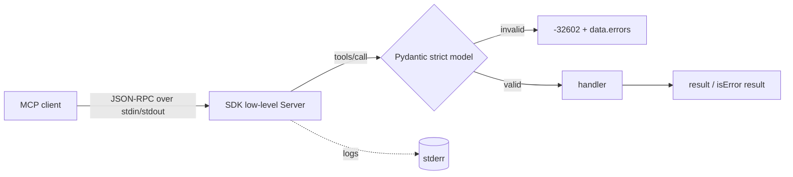
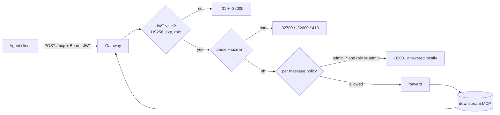
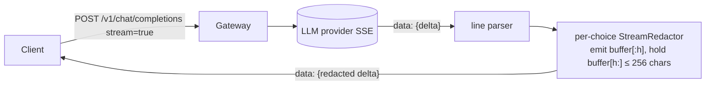
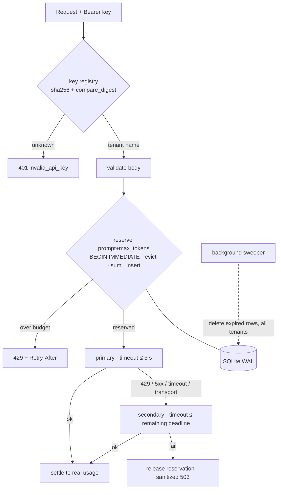

# MCP & LLM Gateway — four tasks, one repo (Python 3.11+)

A custom **MCP server** with strict validation (Task 1), an **MCP security gateway** that does tool-level
RBAC (Task 2), an **LLM gateway that redacts PII from a live token stream** (Task 3), and a
**token-aware rate limiter with provider failover** on on-disk SQLite (Task 4). Every task has its own
test suite (65 tests in total) and a scripted end-to-end scenario, and the whole thing runs with two commands.

```bash
python3 -m venv .venv && source .venv/bin/activate
pip install -r requirements.txt -r requirements-dev.txt

make test        # all four suites (65 tests)
make demo        # starts every service on free ports, runs 17 scenarios, prints PASS/FAIL, kills the servers
make lint        # ruff check + ruff format --check
make typecheck   # mypy --ignore-missing-imports on each task folder
make bench       # redactor vs passthrough micro-benchmark (Task 3)
```

| Task | Folder | Entry point | Tests |
|---|---|---|---|
| 1. MCP server (stdio) | `task1_mcp_server/` | `python server.py` | 4 |
| 2. MCP security gateway | `task2_mcp_gateway/` | `python mock_downstream.py` + `python gateway.py` | 27 |
| 3. Streaming PII guardrail | `task3_pii_stream/` | `python mock_provider.py` + `python gateway.py` | 15 |
| 4. Rate limiter + fallback router | `task4_router/` | `python mock_providers.py …` + `python router.py` | 19 |

CI (`.github/workflows/ci.yml`) runs lint, type-check, tests and the demo on Python 3.11 and 3.12.
Every service reads its port from `PORT`, which is how `make demo` avoids collisions.

---

## Task 1 — Custom MCP server with strict validation & transport handling

**Asked:** a stdio MCP server using the official SDK, exposing `get_customer_record` (`CUST-XXXXX`) and
`trigger_refund` (positive amount, reason ≥ 10 chars), with strict validation, JSON-RPC errors, and a stdout
reserved for the protocol.



**STDIO Isolation.** Three layers: (1) logging is configured on a stderr handler and the code has no `print`;
(2) the SDK's `stdio_server()` writes the protocol to a private duplicate of fd 1 and points fd 1 at stderr while
serving, which also catches C-level writes; (3) after the SDK has claimed the wire, `sys.stdout` is rebound to
stderr. The order matters: rebinding before the claim makes the SDK write JSON-RPC to stderr.
Tests spawn the real process and `json.loads` every stdout line, so any stray byte fails them.

**Protocol Compliance.** Schema violations map to `-32602 Invalid params` with a structured `data.errors` list
(field, message, type — never the raw input). An unknown tool is also `-32602`. An unexpected failure is
`-32603` with a generic message; the stack trace goes to stderr. Business outcomes such as "customer not found"
are returned as `isError: true` tool results, the MCP convention for errors the model should see. Validation
runs before any side effect. Compliance is checked two ways: raw wire tests, and a test that drives the real
server with the **official SDK client** (`ClientSession` + `stdio_client`).

**Validation.** Pydantic v2 models with `strict=True, extra="forbid"`. The same models generate the advertised
`inputSchema`, so the contract and the enforcement cannot drift.

Edge cases handled (each is a test case): `CUST-1`, lowercase `cust-00001`, six digits, integer `customer_id`,
missing field, extra field, amount `-5` / `0` / `"10"` (string) / `true` (bool is an int in Python) / `10.123`
(3 decimals) / `1000000.01` (above cap), reason shorter than 10, reason that is 10 characters only because of
whitespace padding, unknown tool; and the session stays healthy after each protocol error.

## Task 2 — MCP security gateway proxy (tool filtering & auth)

**Asked:** an HTTP reverse proxy in front of a downstream MCP server that reads `Bearer <token>`, extracts a
role, forwards `tools/list`, and answers `tools/call` of `admin_*` tools with `-32001` unless the role is admin —
without calling the downstream server.



**Parsing JSON-RPC wire format structures correctly.** `-32700` parse error; `-32600` for an invalid request,
empty batch, or oversized body (HTTP 413, default 1 MiB, enforced while streaming so the body is never fully
buffered); `-32602` when `tools/call` has no string `params.name`. **Notifications (no `id`) never get a
response body**, even when denied. **Batches** are split: denied entries are answered by the gateway, allowed
ones are forwarded as a smaller batch, and results are merged.

**Proxy middleware construction and HTTP request/response forwarding.** Responses (JSON or SSE) are streamed back
untouched. Hop-by-hop headers are stripped, **the client's bearer token is never forwarded downstream**, and
`Mcp-Session-Id` passes through. If the downstream is unreachable the client gets 502 + `-32003`.

**Fine-grained, method-level authorization logic and clean error handling.** The role comes from a signed
HS256 JWT (signature, `exp` and `role ∈ {admin, viewer}` are all required). Anything doubtful is rejected
(fail closed). The `admin_` check is case- and whitespace-insensitive, so `Admin_reset_key` and ` admin_x` cannot
slip through. Tests prove that a denied call makes **zero** downstream calls.

Edge cases handled (tests): `alg: none` token, right key with HS512/HS384 (algorithm confusion), tampered
signature, expired token, wrong secret, unknown role, missing/`Basic`/empty bearer, malformed JSON, empty batch,
missing `jsonrpc`, non-string tool name, denied notification alone and inside a batch, oversized body (declared
and chunked without `Content-Length`), body exactly at the limit, downstream down.

> Design note: JSON-RPC errors (including `-32001`) are returned with HTTP 200, per JSON-RPC-over-HTTP
> convention; only auth failures (401), oversized bodies (413) and downstream outages (502) use HTTP error codes.

## Task 3 — LLM gateway streaming guardrail (PII redaction)

**Asked:** an LLM gateway endpoint that streams the provider response back while redacting emails, SSNs and
card numbers to `[REDACTED]`, without accumulating the full response, keeping TTFT low.



**Efficient asynchronous stream chunking and buffer state management.** SSE is parsed line by line as bytes
arrive and each event is re-emitted before the next is read, so back-pressure is natural. Each choice (`n>1`)
has its own `StreamRedactor`. Per redactor the only state is a hold-back tail: the shortest suffix that could
still grow into a match (a partial word/email, or a run of digits, spaces and dashes). Everything before it is
final, so it is redacted and emitted immediately. When a choice ends (`finish_reason`), its tail is flushed
**in that same event**, so no content is ever sent after `finish_reason`, and chunks that carry nothing are
dropped instead of being sent empty. If the client disconnects, the upstream stream is closed immediately.

**Performant string/regex pattern matching over partial text streams.** One compiled alternation regex
(email | SSN | card). SSNs exclude invalid areas (000/666/9xx); cards are 13–19 digits with optional separators and
are **Luhn-checked**, so an order number like `1234567890123` passes through. The cut point never falls inside
a complete visible match, so a match is never split across two emits. Per-chunk work is O(chunk + 256).
The key correctness test: for every sample text, 300 random chunkings must produce exactly `redact(full_text)`.

**Memory efficiency and low-latency proxying design.** The tail is capped at 256 characters (≥ the maximum email
length), so memory is O(256) per choice, even for an adversarial 1 MB run of digits (tested). `make bench`
measures the cost in-process (no network); a typical run:

| metric | passthrough | redactor | added |
|---|---|---|---|
| mean per chunk | 0.06 µs | ~4 µs | ~+4 µs |
| p99 per chunk | 0.08 µs | ~13 µs | ~+13 µs |
| TTFT delay | 0 chunks | 1 chunk | +1 chunk (≈ +20 ms at an assumed 20 ms/token) |
| throughput | – | ~260k chunks/s (~3 MB/s) | |
| max retained tail | 0 | 256 chars (cap) | |

The 20 ms figure is a *simulated* upstream pace, not a measurement of a real provider. In plain prose the delay
is about one token (the trailing partial word is held until a boundary arrives).

Edge cases handled (tests): PII split at every possible chunk boundary, invalid SSN areas, Luhn-invalid digit
runs, multiple choices interleaved, role-only and finish-only events, upstream mid-stream error (sanitized
error event, upstream closed), non-object SSE events, invalid JSON request body (400),
client disconnect mid-stream.

## Task 4 — Rate-limiting & model fallback router

**Asked:** a token-aware sliding-window limiter (50,000 tokens/min per tenant key), failover to a backup
provider on 429 or a 3000 ms timeout, sanitized gateway errors, on-disk SQLite.



**Async concurrency handling and timeout race conditions.** Each attempt runs inside `asyncio.timeout(...)`
(connect + send + read). On expiry the in-flight request is cancelled, so a late primary response cannot race the
fallback. A configurable **total deadline** (default 6 s, `GATEWAY_TOTAL_TIMEOUT`) caps primary + secondary
combined: each attempt gets `min(its timeout, time left)`, and the secondary is skipped if nothing is left. The
limiter reserves tokens *before* the call and settles to real usage afterwards, so a burst of concurrent requests
cannot all slip past the check; the test fires 30 concurrent requests at a 1,000-token budget and exactly 9 are
admitted. Check + evict + insert is one `BEGIN IMMEDIATE` transaction, atomic across tasks, threads and processes
sharing the file; SQLite calls run in `asyncio.to_thread`. The release of a failed request is shielded, so a
client disconnect cannot leak a reservation.

**Accurate rate-limiter state eviction and token tracking logic.** A true sliding *log* `(tenant, ts, tokens)`.
Expired rows are deleted in the same transaction as the check, so sums are exact. Tenants who stop calling are
handled by a **background sweeper** (started and cancelled by the app's lifespan) that deletes expired rows for all
tenants in small batches, so the write lock is released between batches. `Retry-After` is exact: it walks the
oldest rows until enough tokens would have expired.

**Tenant authentication (key registry).** Set `TENANT_KEYS_FILE` to a JSON file mapping tenant name to the SHA-256
hex of its API key (or a list of hashes, to run several keys per tenant, e.g. during rotation):
`{"acme": "<sha256 hex>", "globex": ["<hex>", "<hex>"]}`. Build entries with `python hash_key.py <key>`; plaintext
keys are never stored, and the loader rejects anything that is not a 64-char hex digest (the app refuses to start).
The presented key is hashed and compared with `hmac.compare_digest` against every stored digest with no early exit,
so keys of any length work and timing does not reveal which entry matched. An unknown key gets `401 invalid_api_key`
(a missing header is `401 missing_api_key`) **before** the body is parsed, any rate-limit check, or any database
write. The limiter is keyed on the **tenant name**, so all keys of a tenant share one budget and rotating made-up
keys gains nothing. **Development mode:** if `TENANT_KEYS_FILE` is unset, any bearer string is accepted and is its
own tenant (the limiter stores only its SHA-256), and one `WARNING` is logged at startup saying the gateway runs
without a key registry. Do not run that way in production.

**Graceful fallback mechanics and standardized error sanitization.** Failover on 429, timeout, transport error,
5xx, or a malformed body; **not** on other 4xx (a bad request would just be billed twice). Every error has the same
shape, `{"error": {"type", "code", "message", "request_id"}}`. Upstream bodies and stack traces are logged with the
request id and never returned; a catch-all middleware turns any unhandled exception into a generic 500, and
framework 404s/validation errors use the same shape. Tests plant secrets (passwords, internal IPs, tracebacks) in
upstream failures and assert none reach the client.

Edge cases handled (tests): failover on 429 and on timeout (bounded wall-clock), both providers failing (503,
reservation released), 4xx not failed over, request larger than the whole window (400 `request_too_large`, not a
retryable 429), non-object `messages` (400, not 500), SQLite error from the limiter (sanitized 503 + `Retry-After`),
tenant isolation, window eviction with an injected clock, state surviving a restart, sweeper batching; registry:
unknown key (401, zero database rows, no provider call), two keys of one tenant sharing a budget, keys of different
lengths, invalid/plaintext key files, dev mode warning once.

---

## Review notes: bugs found and fixed while preparing this submission

- Task 4: `messages: ["x"]` caused an unhandled `AttributeError` (500); now a 400.
- Task 4: a request bigger than the whole window got a retryable 429 although retrying can never succeed; now a 400.
- Task 4: a SQLite "database is locked" error surfaced as a generic 500; now a sanitized 503 with `Retry-After`.
- Task 4: idle tenants' rows were never evicted; now handled by the sweeper.
- Task 3: invalid JSON bodies caused a 500; non-object SSE events crashed the stream; both handled.
- Task 3: content could be emitted after `finish_reason` and empty chunks were sent; fixed, with a test.

## Trade-offs and what I'd do in production

- **Tenant identity (Task 4).** Keys are authenticated against a hashed registry file (see above). In production
  I would back it with a secrets manager or database, add per-tenant limits and key expiry/revocation, and hash with a
  slow KDF only if keys were low-entropy (API keys are random, so a plain SHA-256 is fine).
- **Rate limiting at scale.** SQLite with `BEGIN IMMEDIATE` is correct across processes on one host, but writers
  serialize. For multi-node deployments use Redis (sorted sets or a Lua token bucket) or a dedicated limiter service.
- **Circuit breaker.** Today every request tries the primary first. A per-provider breaker (open after N failures,
  half-open probes) would avoid paying the 3 s timeout on every request during an outage.
- **Exact tokenization.** Prompt cost uses a ~4 characters/token estimate, which the settle step corrects from the
  provider's real `usage`. A real tokenizer (e.g. tiktoken) would make admission more accurate; I did not add it.
- **Streaming in the router.** Task 4 rejects `stream: true`. Streaming failover is only safe before the first byte;
  after that, mid-stream failover would need to buffer or resume.
- **PII detection.** Regex + Luhn catches structured identifiers only. Names, addresses and free-text secrets need an
  NER model or a DLP service, and the redactor should be made locale-aware (phone numbers, IBANs, national IDs).
- **Auth (Task 2).** A shared HS256 secret is simple but means any holder can mint admin tokens. Use OAuth 2.1 / OIDC
  with JWKS-based asymmetric verification, key rotation, audience checks and scopes instead of a single role claim.
  Also consider rate limiting at the MCP gateway and an allow-list of tools rather than a name prefix.
- **Observability.** Add Prometheus metrics (requests by outcome, failover count, reservations, redactions, tail
  length) and OpenTelemetry traces with the existing request id as the correlation key; ship structured JSON logs.
- **Task 1 data.** Customers are an in-memory mock; a real server would sit on a database, make refunds idempotent
  (idempotency key) and require authorization for the money-moving tool.
